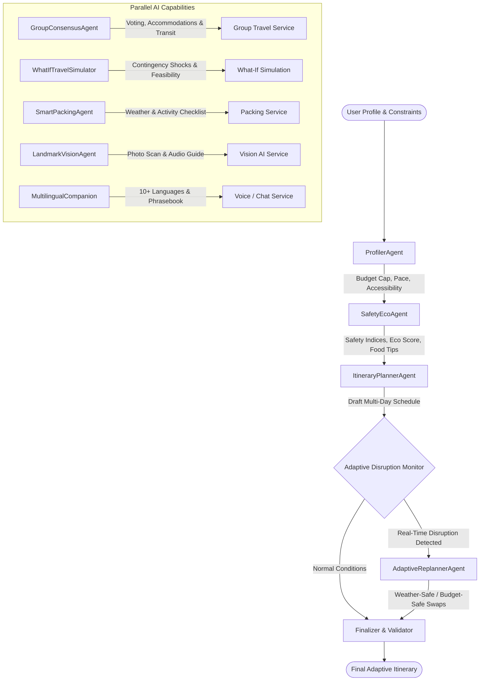

# TRAVELCAMPANION - AI Adaptive Tourism Companion 🌍
### *An Intelligent Personalized and Real-Time Travel Planning Platform*
**AI / AI Agents Lead Implementation**

---

## 📌 Executive Overview

The **AI Adaptive Tourism Companion** is an intelligent, multi-agent tourism platform that generates personalized and dynamically adaptive itineraries for solo travelers, couples, families, friends, college groups, and senior citizens.

Unlike legacy tourism applications that offer static, rigid recommendations, this platform continuously evaluates real-time contextual conditions—such as **weather disruptions, crowd surges, traffic delays, attraction closures, and budget thresholds**—and automatically recalculates itineraries while respecting the user's constraints, accessibility requirements, and budget limits.

---

## 🏗️ Multi-Agent Architecture (LangGraph & Groq)

The AI Architecture is built using **LangGraph** (StateGraph execution engine) powered by **Groq LLaMA 3.3 70B**, delivering ultra-fast inference and context-aware reasoning.

### Agent Workflow Diagram (Mermaid)



### Specialized Agents & Roles

1. **`ProfilerAgent` (`agents/profiler_agent.py`)**:
   - Evaluates traveler dynamics: solo, couple, family, friends, college groups, seniors.
   - Enforces tempo constraints (relaxed vs moderate vs fast-paced) and age groups.
   - Calculates daily budget ceilings (`budget / duration_days`).
   - Assesses accessibility requirements (wheelchair, step-free access, senior-friendly pacing).

2. **`ItineraryAgent` (`agents/itinerary_agent.py`)**:
   - Synthesizes personalized morning, afternoon, and evening activities using genuine, verified real-world landmarks.
   - Balances indoor vs outdoor attractions, cultural landmarks, nature, and authentic dining.
   - Respects location proximity to minimize unnecessary transit friction.

3. **`AdaptiveReplannerAgent` (`agents/adaptive_replanner.py`)** *(Core Project Feature)*:
   - Monitors real-time signals: Sudden torrential rain, crowd surges, traffic gridlocks, venue closures.
   - Automatically identifies impacted outdoor activities and substitutes them with contextually equivalent indoor cultural venues, covered arcades, or nearby attractions.
   - Preserves total budget (strict non-violation guardrail) and ranks top alternative choices with match scores and transit distances.

4. **`SafetyEcoAgent` (`agents/safety_eco_agent.py`)**:
   - Computes an **Eco-Tourism Score (0-100)** and carbon footprint ($kg\text{ CO}_2$).
   - Delivers tourist safety indicators, local advisories, and 24/7 emergency numbers (112, SHE Teams, tourist police).
   - Locates nearest trauma hospitals and outlines immediate crisis protocols.
   - Recommends authentic regional culinary specialties and street food highlights.

5. **`GroupConsensusAgent` (`agents/group_consensus_agent.py`)**:
   - Solves multi-traveler frictions: ranks group interests via Borda/frequency voting and highlights compromises.
   - Computes fair shared group budgets and equalized expense splitting details based on the most budget-conscious member.
   - Recommends **group accommodations** (private multi-bedroom villas, serviced apartments, boutique suites).
   - Recommends **transportation optimization** (AC tempo traveler rental vs rapid electric metro passes vs split cabs).

6. **`SmartPackingAgent` (`agents/smart_packing_agent.py`)**:
   - Classifies destination climate (Alpine, Arid, Tropical, Temperate) and scheduled activities.
   - Generates interactive, categorized packing checklists (Clothing, Weather Gear, Medical/First-Aid, Electronics, Eco-Essentials).

7. **`LandmarkVisionAgent` (`agents/landmark_vision_agent.py`)**:
   - Computer Vision & Multimodal landmark identifier.
   - Identifies monuments (Charminar, Golconda Fort, Taj Mahal, Eiffel Tower, Colosseum, etc.) from images/hints.
   - Supplies architectural era, historical significance, visiting hours, ticket prices, wheelchair accessibility, and a 30-second audio guide narration script.

8. **`WhatIfTravelSimulator` (`agents/what_if_simulator.py`)**:
   - Predictive contingency simulator: evaluates 25% budget cuts, unexpected monument closures, severe storm warnings, and senior mobility fatigue.
   - Outputs feasibility scores (0-100), impact analysis, and adjusted itineraries.

9. **`MultilingualCompanionAgent` (`agents/multilingual_companion_agent.py`)**:
   - Converses fluently in 10+ languages (English, Hindi, Telugu, Tamil, French, Spanish, Japanese, etc.).
   - Generates localized colloquial phrasebooks and spoken audio scripts formatted for Web Speech synthesis.

---

## 📁 Project Folder Structure

```
ai_tourism_companion/
│
├── .env.example                 # Template for Groq API Key and model settings
├── .env                         # Environment variables configuration
├── requirements.txt             # Project dependencies (LangGraph, Groq, FastAPI, Streamlit)
├── README.md                    # Comprehensive AI Architecture documentation
├── AI_ROLE_PROJECT_REPORT.md    # Detailed Academic Report & Viva Defense Guide
│
├── config.py                    # Groq ChatGroq LLM initialization with mock fallback
├── schemas.py                   # Pydantic data schemas for profiles, itineraries, disruptions
├── real_places_db.py            # Curated catalog of real, existing global & Indian landmarks
│
├── agents/                      # Specialized AI Agents
│   ├── __init__.py
│   ├── profiler_agent.py        # Evaluates constraints, tempo, and accessibility
│   ├── itinerary_agent.py       # Synthesizes personalized schedules
│   ├── adaptive_replanner.py    # Live real-time adaptation and ranked conflict substitution
│   ├── group_consensus_agent.py # Multi-traveler voting, accommodations & transit optimization
│   ├── safety_eco_agent.py      # Safety indices, emergency helplines, and eco-scoring
│   ├── smart_packing_agent.py   # Weather and demographic-aware packing checklist generator
│   ├── landmark_vision_agent.py # Computer vision and multimodal monument identification
│   ├── what_if_simulator.py     # Hypothetical scenario contingency testing
│   └── multilingual_companion_agent.py # Multilingual conversational assistant & phrasebooks
│
├── graph/                       # LangGraph StateGraph Execution Pipeline
│   ├── __init__.py
│   ├── state.py                 # TourismState TypedDict schema
│   └── tourism_graph.py         # StateGraph nodes, conditional edges, and execution graph
│
├── integration/                 # Ready-to-Use Contracts for Spring Boot, React, and MySQL
│   ├── SpringBootAIServiceClient.java # Reactive WebClient calls for Spring Boot backend
│   ├── aiApiService.ts          # TypeScript Axios client for React.js frontend
│   └── mysql_schema.sql         # 10 relational tables for MySQL storage
│
├── api.py                       # FastAPI REST Service (10 endpoints ready for Spring & React)
├── run_demo.py                  # CLI test script demonstrating all 8 core AI capabilities
└── web_app.py                   # Streamlit Interactive 8-Tab Dashboard for live project demo
```

---

## 🚀 Quickstart Guide

### 1. Setup Environment
```bash
cd C:\Users\ss\.gemini\antigravity\scratch\ai_tourism_companion
pip install -r requirements.txt
```

### 2. Configure Groq API Key (Optional)
Open `.env` and set your key from [Groq Console](https://console.groq.com/keys):
```ini
GROQ_API_KEY=gsk_your_actual_groq_key_here
GROQ_MODEL=llama-3.3-70b-versatile
GROQ_TEMPERATURE=0.3
```
> **Note:** If you run the code without an API key, the built-in intelligent fallback automatically activates, allowing you to run all tests and flows offline!

---

## 🧪 Testing & Demonstrations

### Option A: Run CLI Demo (All 8 Scenarios)
Execute the end-to-end command-line demonstrator:
```bash
python run_demo.py
```
This demonstrates:
1. **Scenario 1:** Generating a 3-Day Hyderabad cultural itinerary with wheelchair access.
2. **Scenario 2:** Live weather disruption on Day 1 Morning -> dynamic indoor swap with ranked alternatives.
3. **Scenario 3:** Group travel consensus, fair budget splitting, accommodations, and transit optimization.
4. **Scenario 4:** Smart packing checklist for destination climate and activities.
5. **Scenario 5:** Computer vision landmark scanning (Charminar & Golconda Fort) with audio guide script.
6. **Scenario 6:** What-If travel simulator testing a 25% budget cut and unexpected venue closure.
7. **Scenario 7:** Multilingual conversational companion in Hindi with local Hyderabad phrasebook.
8. **Scenario 8:** Tourist safety indicators and 24/7 SOS emergency assistance protocols.

### Option B: Run Interactive Web UI (Streamlit Presentation Dashboard)
Launch the interactive web companion:
```bash
streamlit run web_app.py
```
This opens an 8-tab visual interface ideal for presentations and viva evaluations.

### Option C: Run FastAPI Backend Microservice
Launch the REST API server:
```bash
uvicorn api:app --reload --port 8000
```
- Interactive Swagger API Documentation: `http://localhost:8000/docs`
- Health check: `http://localhost:8000/api/health`

---

---

## 🗄️ Database Architecture: Supabase PostgreSQL

The application integrates with **Supabase PostgreSQL** for cloud-native persistence:

- **Schema definition:** [`supabase_schema.sql`](file:///C:/Users/ss/.gemini/antigravity/scratch/ai_tourism_companion/supabase_schema.sql)
- **Database Client:** [`supabase_client.py`](file:///C:/Users/ss/.gemini/antigravity/scratch/ai_tourism_companion/supabase_client.py) (uses `supabase-py 2.33.0` with resilient local caching fallback)

### Managed Tables in Supabase:
1. `trips` — Destination, duration, total budget, party size, traveler type, and accessibility needs.
2. `itineraries` — Multi-day timeline, day-by-day morning/afternoon/evening activities, eco-scores, and safety advice stored as JSONB.
3. `hotel_bookings` — Confirmed lodge/hotel bookings with room sharing rates (dormitory, twin sharing, private deluxe) in ₹ INR.
4. `chat_interactions` — Full conversation history, executed UI actions (`SET_DESTINATION`, `SWITCH_DAY`, `SET_DURATION`, `REPLAN`), and language preferences.
5. `landmark_scans` — Multimodal Vision AI monument recognition records and historical audio transcripts.

### Supabase Setup in 2 Minutes:
1. Create a project at [supabase.com](https://supabase.com).
2. Open your Supabase project dashboard -> **SQL Editor**.
3. Copy and paste the contents of `supabase_schema.sql` and click **Run**.
4. In your `.env` file, set your keys:
   ```env
   SUPABASE_URL=https://your-project.supabase.co
   SUPABASE_KEY=your-supabase-anon-or-service-role-key
   ```

---

## 🚀 Running the Full Stack Application

### 1. Backend (FastAPI Microservice)
```bash
# Install Python dependencies
pip install -r requirements.txt

# Start FastAPI server
python -m uvicorn api:app --host 127.0.0.1 --port 8000 --reload
```
- Interactive Swagger API Docs: `http://127.0.0.1:8000/docs`
- Health check & Supabase status: `http://127.0.0.1:8000/api/health`

### 2. Frontend (React 19 + Vite + Tailwind CSS)
```bash
cd frontend
npm install
npm run dev
```
- Open browser at: `http://localhost:3000`
- Production build: `npm run build`

---

## 🔌 API Reference & Endpoints

| Endpoint | Method | Description |
| :--- | :--- | :--- |
| `/api/itinerary/generate` | `POST` | Synthesizes multi-day itinerary and saves to Supabase |
| `/api/itinerary/adapt` | `POST` | Dynamically recalculates schedule during disruptions |
| `/api/chat/companion` | `POST` | Conversational companion & real-time action executor |
| `/api/vision/recognize-landmark` | `POST` | Multimodal AI landmark recognition & audio guide |
| `/api/distance/calculate` | `POST` | Geodesic logistics for bike, train, car, and flight |
| `/api/hotels/near` | `POST` | Verified Day 1 lodges with room sharing rates in ₹ INR |
| `/api/bookings/hotel` | `POST` | Records room reservation in Supabase |
| `/api/trips` | `GET` | Lists saved trips from Supabase |
| `/api/supabase/status` | `GET` | Live Supabase connection diagnostics |

>>>>>>> d0704c7 (feat: AI Tourism Companion with FastAPI backend, Supabase database, and React frontend)
